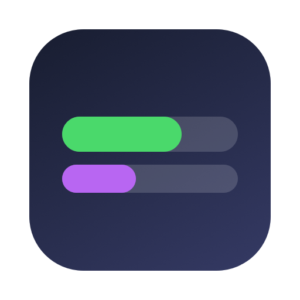
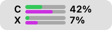
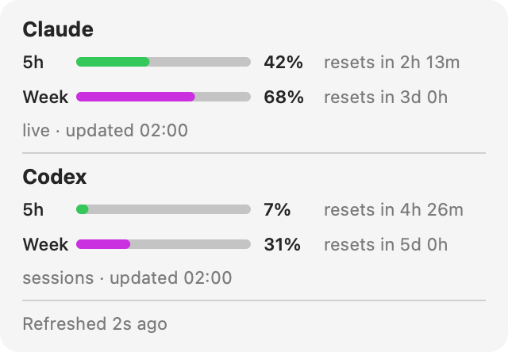

<p align="center"></p>

# Tokenly

A tiny macOS menu-bar app that shows your **Claude Code** and **Codex** subscription limits as progress bars.

<p align="center">
  <picture>
    <source media="(prefers-color-scheme: dark)" srcset="docs/menubar-dark.png">
    
  </picture>
  &nbsp;&nbsp;&nbsp;
  <picture>
    <source media="(prefers-color-scheme: dark)" srcset="docs/dropdown-dark.png">
    
  </picture>
</p>

Green is the 5-hour window, purple the weekly one (red from 90 %).

- Two bars per tool in the menu bar (5h + week). The number is the 5h percentage.
- Click it for a detail list: percentage and time until reset for each window.
- Refreshes every 5 seconds. Data older than an hour is dimmed.
- Notifications at **80 %** and **95 %** for the 5h and the weekly window, and when a window resets.
- Optional **auto-start**: when your 5h window has ended and you aren't using it, send one tiny message so the next window starts counting right away (off by default).

> **Unofficial.** Not affiliated with or endorsed by Anthropic or OpenAI. The Claude live source uses an undocumented endpoint that can change or stop working at any time. Use at your own risk.

## Install

Requirements: macOS with the Xcode command line tools (`xcode-select --install`), and Claude Code and/or Codex already signed in.

```bash
git clone https://github.com/MohamedAbd0/tokenly.git
cd tokenly
bash Tokenly/install.sh
```

This builds the app, copies it to `~/Applications/Tokenly.app` and starts it at every login (a LaunchAgent). Re-run it to update.

Uninstall:

```bash
launchctl bootout gui/$(id -u)/local.tokenly
rm -rf ~/Applications/Tokenly.app ~/Library/LaunchAgents/local.tokenly.plist
```

## Where the numbers come from

| Tool | Source |
|------|--------|
| **Codex** | The newest `rate_limits` event in `~/.codex/sessions/**/*.jsonl`. Local only. Updates when you use Codex. |
| **Claude (live)** | Tokenly reads Claude Code's own login from the macOS Keychain (`Claude Code-credentials`) **at runtime** and asks `api.anthropic.com/api/oauth/usage` about once a minute. This works from the CLI, the VS Code extension and the desktop app. macOS will ask you to allow Keychain access; choose *Always Allow*. |
| **Claude (CLI fallback)** | If the live source is unavailable, Tokenly reads `~/.claude/.usage.json`, written by Claude Code's status line (CLI sessions only). To enable it, add this right after `input=$(cat)` in your `~/.claude/statusline.sh` (needs `jq`): |

```bash
printf '%s' "$input" | jq -ce 'select(.rate_limits != null) | {ts: (now|floor), rate_limits: .rate_limits}' > ~/.claude/.usage.json.tmp 2>/dev/null && [ -s ~/.claude/.usage.json.tmp ] && mv ~/.claude/.usage.json.tmp ~/.claude/.usage.json
```

The dropdown shows which source is in use (`live`, `CLI` or `sessions`) and the reason if the live source fails.

## Auto-start

Turn on **Auto-start Claude window** / **Auto-start Codex window** from the menu. When Tokenly positively sees that the 5h window is over, it runs the official CLI once with a one-word message:

- `claude -p ok --model haiku --no-session-persistence --tools "" …`
- `codex exec … ok`

It never sends again within 5 hours of a successful start, and retries a failure no sooner than 10 minutes later. Each message uses a small slice of your quota (a Codex message is roughly 12k tokens because of its system prompt). Codex sessions are written to `~/.codex/sessions` so Tokenly can see the new window.

## Privacy and safety

- No telemetry, no accounts. The only network call Tokenly makes itself is the usage request to `api.anthropic.com`, with your own token. The token is read from the Keychain when needed, kept in memory, and never logged or written to disk.
- Tokenly doesn't modify your files. The one optional change (the status-line snippet above) is yours to make.
- Notifications are silent banners except the 95 % alert and auto-start failures.

## Development

One file, no dependencies: [`Tokenly/main.swift`](Tokenly/main.swift).

```bash
bash Tokenly/build.sh                          # builds Tokenly.app here
Tokenly.app/Contents/MacOS/Tokenly --selftest  # parser/alert/auto-start logic checks
Tokenly.app/Contents/MacOS/Tokenly --print     # print what the menu would show
Tokenly.app/Contents/MacOS/Tokenly --screenshots docs  # re-render the README images (sample data)
```

The icon is drawn by [`Tokenly/icon/make-icon.swift`](Tokenly/icon/make-icon.swift).

## License

[MIT](LICENSE)
